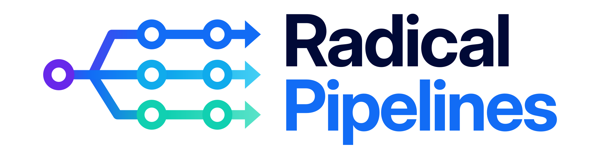

# Project Description



An agent orchestrator that runs teams of agents autonomously through a pipeline of defined phases, where each phase produces concrete, inspectable artifacts.

## The problem

Today, most of us use agents in what we'd call "assisted mode". We give them a rough idea, they start implementing, and we sit next to them correcting the course along the way. This works, but it's a workaround for two structural gaps, not a deliberate workflow.

**The first is the lack of requirements.** Without clear specs, the agent picks a direction and the human has to steer it in real time. But agents are already capable of implementing autonomously if the requirements are well-defined. Assisted mode is a workaround for missing requirements, not a limitation of the agents themselves.

**The second is the lack of determinism.** Agent output is non-deterministic. The same prompt, the same context, can produce a different result every time. So even when the human knows exactly what they want, they still assist because the agent might take a bad path this particular run.

Beyond that:

- **Assisted mode has no structure.** There's no systematic process that guarantees the right assets get produced. Whether tests, documentation, or other artifacts get generated depends entirely on the human remembering to ask for them.

- **Assisted mode is inherently local.** The context built up along the way, the decisions made, and the intermediate output only exist on the machine of the person doing the work. The final PR is the only thing the team gets to see, which makes it hard to coordinate or have multiple people work on the same task.

## The proposal

An agent orchestrator that runs teams of agents autonomously through a pipeline of defined phases. Each phase produces concrete, inspectable assets, and the pipeline can run partially or fully without human intervention.

The phases are:

- **Phase 0. Intent.** The initial request, binding constraints, and proposals to investigate.
- **Phase 1. Spec.** Requirements, acceptance criteria and out of scope.
- **Phase 2. Design doc.** Architecture, technical decisions, and where each outcome is proven.
- **Phase 3. Build.** The build plan and its tasks, the code with the unit and end-to-end tests the design doc calls for, and behavior verification.
- **Phase 4. Document.** The document plan and its tasks, and both internal and external documentation.

Planning is not a separate phase: the Build and Document phases each begin by committing a plan and getting it approved.

In this model (see the [glossary](./docs/glossary.md)), a pipeline is a converging set of artifacts: it is done when every artifact through the target phase exists, is approved, is fresh with respect to its inputs, its tasks are executed, every in-scope challenge and claim is resolved, and its phase reviews have seen all of its code. State is computed from the tree. Each agent commits the screenshots, logs, transcripts, and helper answers its file cites in a supporting folder beside that file, outside pipeline state. Later input is recorded in phase 0 as one `constraint-<n>.md` per binding ruling or `proposal-<n>.md` per request to investigate, each with `target:` and `origin:`. Proposals may be adopted or refuted with evidence; constraints must be satisfied. The earliest target is handled first, and each target resolves its part through consumption and an approving review wave. A Build input therefore starts at Build; changed artifact identities drive the normal downstream cascade. Requirements cover the cases the intent makes material; a design mechanism is proportionate to that, and the case it leaves uncovered is recorded with its consequence and judged by it. Each phase binds at its boundaries and leaves the inside to the phase that observes it: the design doc decides contracts, the build worker the code within them and its tests, the document planner assigns documentation areas and the document writer determines each file's readers, content, and depth from the documentation and the shipped code; an obligation an agent chose is that agent's to revise. Build delivers the shipped code — code, tests, and configuration, with their comments and inline API documentation — and Document all other documentation; what an obligation requires of either is that phase's to plan, deliver, and judge. An unsatisfiable input travels as a claim to its target; only the intent's Goal and constraints, including constraint files, require the owner's ruling. A constraint or a proposal answers an owner claim when it cites that claim and targets the root artifact of the phase that raised it, returning work there. A task report ends `completed`; `failed` — the product was observed and contradicts the task, or the task is contradictory or incomplete, with reproducible evidence; or `blocked` — something the worker was given failed it — malformed materials, an unreadable input, or a broken seat or its environment — and the report names what failed, with the evidence locating it, for the orchestrator to repair before the next attempt.

Every orchestrator synthesis of incoming work is shown to the owner as it will be recorded, in plain language, explaining what is binding, what remains open to investigation, and what it affects. The owner approves that synthesis before it is written, including input from pull-request reviews and CI. An issue already in intent format, with no comments, references, links, or attachments to synthesize, is copied directly. Approving a proposal authorizes investigation, not its proposed outcome.

The Spec and Design doc phases can run **multilane**: named production lanes, each with its own brief and model, produce and review a candidate in `<phase>/lanes/<lane>/` — in parallel, or one after another to diverge from what came before — then a producer in Consolidate mode merges the candidates into one canonical artifact for final adversarial review. Without lanes, the plain single flow. Each pipeline records its workflow, target phase, and lanes in `run-config.md`; the file remains with the merged pipeline.

The pipeline is **autonomous by default, assisted when needed.** After triage, questions are reserved for owner escalations and approval of incoming work. While waiting for agents, the orchestrator ends its turn and resumes on incoming messages or scheduled health ticks. The Spec and Design doc phases can instead run in assisted mode.

It is **inspectable.** Every phase produces artifacts your team can review before the final PR. A phase review covers the code as its reviewer saw it; [`rp diff`](./skills/radical-pipelines/scripts/README.md#diff) renders what changed since, however the branch was rebased or merged.

It can add **determinism through redundancy.** For complex tasks, you should be able to spend more tokens on the same surface with multiple runs, validation checks, adversarial agents, and different models from different providers to converge on a more reliable output.

## What this unlocks

- **Parallel throughput.** Instead of assisting one agent at a time, a human can launch multiple autonomous pipelines and review their outputs when they're done. The constraint shifts from "how many agents can I supervise" to "how many can I review".
- **Compounding quality.** When a pipeline produces a bad result, incoming work targets the artifact where it diverged (a wrong assumption in the spec, a missing constraint in the design doc). Its effects cascade through every downstream artifact, not just the output that exposed it.
- **Consistent assets.** Tests, documentation, and other artifacts that today depend on human diligence become a planned, reviewed part of every run.
- **Shareable work-in-progress.** Because every phase produces a concrete artifact, the state of a task becomes visible across the team long before a PR exists. Multiple people can review intermediate outputs and advance the same task through the pipeline, instead of only being able to react to the final result.

## Why now

- **Agents have crossed the quality threshold.** They are already capable of executing autonomously and doing a very good job, as long as the requirements are well-defined.
- **Human attention is becoming the bottleneck.** As agent adoption grows, the limiting factor in development is no longer the agents' ability to write code, it's the human time spent assisting them. Every hour spent steering an agent in real time is an hour not spent on decisions that actually need a human. And even when agents go off track, it's more optimal to inspect where they deviated, supply the correction, and let the pipeline converge autonomously, rather than assisting them step by step.
- **The tooling is mature enough.** Tools like Claude Code already provide the necessary primitives (skills, teams of agents, agent definitions, hooks...) to build a pipeline like this without a large investment in custom infrastructure, and for this reason, whatever is built can evolve naturally alongside them as they improve.

## Success metrics

- **Human time per task.** For a set of representative tasks, measure the total human time spent when using the pipeline vs. assisting an agent directly. The pipeline should require significantly less human time per task.
- **Pipeline completion rate.** Percentage of tasks that make it from intent through the target phase without requiring human intervention. A higher rate means the pipeline is genuinely autonomous, not just deferring work to the human at every checkpoint.
- **Correction efficiency.** When a human supplies a correction, how many review waves does it take to reach an acceptable result? Fewer rounds mean the pipeline is surfacing the right information for the human to make effective corrections.
- **Autonomy ratio.** For each task, the number of phases that ran autonomously vs. the number that required human intervention. Tracking this across tasks shows whether the pipeline is trending toward more autonomy over time, or whether certain phases consistently need a human.

# Project Usage

The repository ships a Claude Code plugin, an opencode plugin, and a standalone [agent skill](https://agentskills.io). All three capture the same methodology so a compatible agent can run a task through the pipeline. The two plugins install per tool — see [Claude Code plugin install](#claude-code-plugin-install) and [opencode plugin install](#opencode-plugin-install).

## Claude Code plugin install

Claude Code installs plugins through marketplaces. This repository ships an `automattic` marketplace catalog (`.claude-plugin/marketplace.json`) that currently lists only the Radical Pipelines plugin (`.claude-plugin/plugin.json` at the repo root). Naming the marketplace `automattic` rather than `radical-pipelines` anticipates a future move to a centralized `Automattic/claude-plugins` repo without changing the install command users have memorized.

To install from the public repository:

```text
/plugin marketplace add Automattic/radical-pipelines
/plugin install radical-pipelines@automattic
```

To install from a local checkout instead — useful for verifying that a local edit to `marketplace.json` is well-formed before pushing — point `marketplace add` at the directory:

```text
/plugin marketplace add ./radical-pipelines
/plugin install radical-pipelines@automattic
```

This installs the plugin into Claude Code's cache the same way the public-repository install does.

For active local development, skip the marketplace flow entirely and load the plugin directly from a checkout with Claude Code's `--plugin-dir` flag:

```bash
claude --plugin-dir ./radical-pipelines
```

This reads the plugin from the working tree on each start (no cache copy), so edits in `skills/radical-pipelines/` are picked up without reinstalling.

The plugin currently bundles:

- the `radical-pipelines` skill, a real directory at `skills/radical-pipelines/`.
- agent profiles in the root `agents/` directory.

Plugin skills are namespaced by the plugin name in Claude Code (not by the marketplace name). After installing, invoke the skill with `/radical-pipelines:radical-pipelines` or ask Claude Code to run Radical Pipelines.

A long run outlives its context: when Claude Code compacts a session, it re-injects the body of every invoked skill, and the skill opens with the instruction for exactly that moment — treat the summary as unreliable, follow the skill again as at first sight, and resume a run under way without triage, checking which agents are already working before dispatching. No hook is needed.

The skill at `skills/radical-pipelines/` and the agent profiles in `agents/` are the real sources, served directly from the repository root: the directories the Claude Code plugin reads are the canonical sources themselves, with no hidden source directory and no mirror-symlink scheme.

## opencode plugin install

Radical Pipelines supports stable opencode v2 (the `opencode` binary). Install it through opencode's global plugin configuration using its Git source.

Add RP to the `plugins` array in your global `~/.config/opencode/opencode.json`:

```jsonc
{
  "$schema": "https://opencode.ai/config.json",
  "plugins": ["github:Automattic/radical-pipelines"]
}
```

Then restart the opencode service:

```bash
opencode service restart
```

A single restart is enough — the plugin finishes its setup before opencode scans agents, so the skill and every agent are usable as soon as the service is back. After the restart:

- The `radical-pipelines` skill is invokable, and a session that activated it gets it back after opencode's context compaction.
- RP's agent profiles register as `radical-pipelines/<name>`; `rp_spawn` accepts the plain profile name, and the plugin's tools are scoped to the calling session — the orchestrator reaches every tool, a spawned agent only `rp_send`, a subagent none.
- A spawned agent reports to its spawner with `rp_send`; the plugin announces its failed turns and those that end without a message, and its out-of-worktree read requests to the spawner, which answers with `rp_permission_reply` and ends the agent with `rp_terminate`.
- `rp_status` reports pipeline health with `pipeline_slug` and investigates one agent with `session`; a read that fails leaves its facts unknown rather than reporting a healthy pipeline.
- Health loops skip active sessions, steer into stalled ones, back off while the target's turns fail, interrupt a dead provider stream once, and retire when the target is gone.

The full behavior — the skill re-supply mechanism, status fields, the health loop's dead-stream heuristic and its single-observer assumption, and tool scoping — is documented in [docs/opencode-plugin.md](./docs/opencode-plugin.md).

### Updating

Update the configured Git plugin and restart:

```bash
opencode plugin update github:Automattic/radical-pipelines
opencode service restart
```

The plugin refreshes its packaged skill and materialized agents during setup. Use `opencode plugin check` to check for available plugin updates.

### Checking the installed version

opencode reports plugin ids, not versions, so RP surfaces its own version:

- Run the `rp_status` tool: its `pluginVersion` reports the running plugin as `radical-pipelines@<version>`, where `<version>` is the installed RP version.
- opencode's HTTP API reports the same id: `opencode api GET /api/plugin` returns the `radical-pipelines@<version>` plugin id.

## Configuration

The skill is generic: each project records its conventions in a committed `.rp.md`. Its frontmatter, a JSON object, carries `"conventions": <version>`, the version of the conventions format, so the loader can migrate older files or ask the owner to update the skill when a file is newer. If the file is absent or required conventions are missing, the interactive setup writes it only after the owner confirms the proposed content.

| Convention             | What it covers                                                                             | Required |
| ---------------------- | ------------------------------------------------------------------------------------------ | -------- |
| Issues                 | Issue storage, operations, and the canonical issue reference                               | Yes      |
| Pipeline slug          | How the pipeline's identifier is derived from its issue                                    | Yes      |
| Pipeline branch format | The pipeline branch as a template over the slug; default the slug itself                   | No       |
| Pipelines folder root  | Where pipeline folders live                                                                | No       |
| Artifact storage       | Whether artifacts live in the project's repository or a fork, and the artifact base branch | Yes      |
| Worktree folder root   | Where worktrees live                                                                       | Yes      |
| Commit format          | How agents write commits                                                                   | No       |
| PR format              | How pull request titles and descriptions are written                                       | No       |
| Guardrails             | Rules the project's agents must satisfy                                                    | No       |
| Resources              | What the project's agents have available and how to use it                                 | No       |
| Lifecycle hooks        | Prose instructions run at defined pipeline moments                                         | No       |
| Agents                 | Defaults for profile models and named lanes                                                | No       |
| Health monitoring      | Health-loop interval and stall threshold                                                   | No       |

A developer can override conventions for their own working copy with a git-ignored `.rp.local.md` alongside `.rp.md`: the local file wins per named unit, and the committed file supplies everything else. The active tool's mechanics — spawning, agent IDs, messaging, seating, termination, health monitoring, and model values — live in the skill's [`tools/`](./skills/radical-pipelines/tools/) files; the active tool section in `.rp.md` overrides or extends them. See the [convention loader](./skills/radical-pipelines/reference/conventions/load.md) and [setup flow](./skills/radical-pipelines/reference/conventions/setup.md) for the full procedure.

Producers and reviewers report blockers for malformed materials, unreadable inputs, and broken seats or their environments whenever found. Workers report them before their first write; after it, the same failure is a `blocked` report. A failure that passes when rerun on unchanged work is intermittent: it blocks a worker or a review only when the work changes what it exercises.

## Changelog and versioning

The repository tracks every change in a changelog and keeps a single project version in sync across the files that declare it. It uses [Changesets](https://github.com/changesets/changesets) to record changes and drive version bumps, and a small sync step to propagate the bumped version to every version-bearing file. The configuration lives in `.changeset/config.json` and `@changesets/cli` is a development dependency of the root `package.json`.

### Adding a changeset

Per the repository's standing rule — alongside the README-update rule — every change to the repository records a changeset. A changeset is a committed `.changeset/*.md` file that describes the change and declares its bump type (`patch`, `minor`, or `major`). It travels with the pull request and accumulates on `trunk` until a release is cut; it is not consumed when the PR merges. The matching rule lives in [`AGENTS.md`](./AGENTS.md).

For how to author a changeset, choose its bump type, and when one is required, see [`CONTRIBUTING.md`](./CONTRIBUTING.md#adding-a-changeset).

### The single source of truth

The `version` field in the root `package.json` is authoritative. The other version-bearing locations are kept identical to it and are never edited independently:

- `.claude-plugin/plugin.json`
- `package-lock.json` — in two fields, the top-level `version` and the root package's `packages[""].version`.

`.claude-plugin/marketplace.json` carries no version field — it references the plugin by `source: "./"` — so it is intentionally left out of version sync.

### Cutting a version

Releases are driven by CI (`.github/workflows/release.yml`), not by a local operator action. Changesets accumulate on `trunk` until a release is cut; the flow is:

1. **Changesets land on `trunk`.** As pull requests merge, their `.changeset/*.md` files pile up on `trunk`.
2. **CI opens a "Version Packages" PR.** With pending changesets, the Release workflow runs `npm run release:version` and surfaces the result as a "Version Packages" pull request. In one fail-fast invocation that script: (a) runs `changeset version` to consume the pending `.changeset/*.md` files, write or update the root `CHANGELOG.md`, and bump the `version` in the root `package.json`; (b) runs `node scripts/sync-version.mjs` to copy the new root version into `.claude-plugin/plugin.json`; (c) reconciles `package-lock.json` so its two recorded-version fields match the bumped root version. After it runs, all version-bearing locations — `package.json`, `.claude-plugin/plugin.json`, and the two `package-lock.json` fields — read the same string.
3. **A maintainer merges the Version Packages PR.** The human merge is what advances the flow.
4. **CI creates the tag and Release.** The next run creates the `v<version>` git tag and a matching GitHub Release.

There is no `npm publish` — the root package is `"private": true` and both artifacts are consumed direct-from-git — but a release now produces a `v<version>` git tag and a GitHub Release via CI.

The full maintainer procedure, the manual escape hatch for cutting a release locally, and the `GITHUB_TOKEN` a local `npm run release:version` requires (because `@changesets/changelog-github` needs it) live in [`CONTRIBUTING.md`](./CONTRIBUTING.md).
