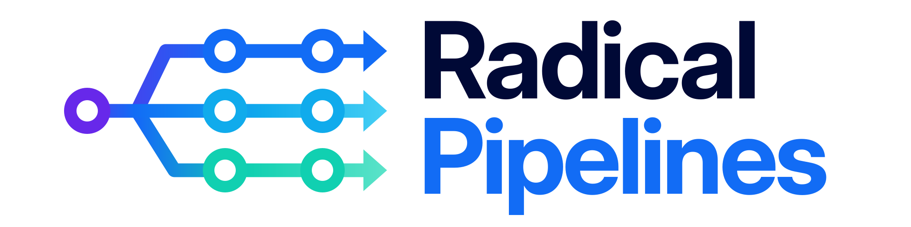

# Project Description



An agent orchestrator that runs teams of agents autonomously through a pipeline of defined phases, where each phase produces concrete, inspectable artifacts.

## The problem

Today, most of us use agents in what we'd call "assisted mode". We give them a rough idea, they start implementing, and we sit next to them correcting the course along the way. This works, but it's a workaround for two structural gaps, not a deliberate workflow.

**The first is the lack of requirements.** Without clear specs, the agent picks a direction and the human has to steer it in real time. But agents are already capable of implementing autonomously if the requirements are well-defined. Assisted mode is a workaround for missing requirements, not a limitation of the agents themselves.

**The second is the lack of determinism.** Agent output is non-deterministic. The same prompt, the same context, can produce a different result every time. So even when the human knows exactly what they want, they still assist because the agent might take a bad path this particular run.

Beyond that:

- **Assisted mode has no structure.** There's no systematic process that guarantees the right assets get produced. Whether tests, documentation, or other artifacts get generated depends entirely on the human remembering to ask for them.

- **Assisted mode is inherently local.** The context built up along the way, the decisions made, and the intermediate output only exist on the machine of the person doing the work. The final PR is the only thing the team gets to see, which makes it hard to coordinate or have multiple people work on the same task.

## The proposal

An agent orchestrator that runs teams of agents autonomously through a pipeline of defined phases. Each phase produces a concrete artifact committed to the repository, and the pipeline runs to the phase you choose without human intervention.

The phases are:

- **Phase 0. Intent.** The owner's goal, binding constraints, and proposals to investigate, approved by the owner before it is written.
- **Phase 1. Spec.** Requirements, acceptance criteria, exclusions, and the cases considered and not required. Every requirement traces to the intent.
- **Phase 2. Design doc.** Component responsibilities, their contracts, and the decisions behind them, each serving named requirements.
- **Phase 3. Implementation.** The code, its tests, and its documentation, built by one implementer that holds the whole change.
- **Phase 4. Review.** The change judged as a whole against the intent, by reviewers who see only what a pull-request reviewer sees: the issue and the change.

The full model, and why it differs from the previous architecture, is in [docs/model.md](./docs/model.md). Terms are defined in the [glossary](./docs/glossary.md).

### Roles

Each artifact has one owner, which answers for it:

- **The orchestrator** is the session that runs the skill. It talks with the owner, records phase 0, creates branches and worktrees, wakes the role the pipeline's state names, and opens the pull request. It judges no content and relays no message.
- **`spec-producer`** owns the spec, **`design-doc-producer`** the design doc, and **`implementer`** the code, its tests, its documentation, and `notes.md`, the file it resumes from. **`reviewer`** owns the review thread of its lane and talks only with the implementer, who carries a finding that questions a requirement or a design decision to that clause's owner.

Each role works from its assignment: the filled prompt the orchestrator writes into the role's worktree git directory before every turn, which the role rereads at each turn and after a compaction. Every role delegates bounded work to its tool's own subagents, on the subagent model its assignment names, and stays responsible for what they return.

### Observe the present, assume the future

Every role runs with full execution: it reads, runs, builds, and drives the software, starts the environments the project lists under **Resources**, and reproduces failures. A claim about what the system does today is observed, and the artifact says how. A claim about what the solution will do is assumed, and the artifact says what will confirm it; the implementer verifies it. Only the implementer writes solution code.

The burden is on the clause. A requirement or decision the owner did not state stands only with a trace to the intent and an input observed in intended use: a use the intent names, or one the project's documentation or code shows a consumer making. In a dispute, observed stands and conceivable falls. The spec lists the cases its producer examined and left out under **Considered and not required**, so they are not raised again.

### Threads

Roles talk through threads: one file per conversation between two roles about one artifact, in the pipeline's `threads/` folder. A role that finds a problem in an artifact it consumes opens a thread to that artifact's owner; nobody opens one downstream. Each message ends its author's turn. The orchestrator wakes the addressee, which revises its artifact and answers each finding with the commit that addresses it, or with why the artifact stands.

A dispute about a derived requirement or a design decision is settled inside its thread by observation. Where the intent's words leave a question open, the producer takes the reading the Goal and intended use support and records the other in the artifact, where the owner can correct it. Only a disagreement between roles about what the intent means or demands, or evidence that every kind of approach fails it, reaches the owner. Artifacts hold only the final truth; the discussion stays in the threads.

### Pins and state

Each artifact pins, in its frontmatter, the exact version of every input it consumed. When an input changes — the owner edits the spec, a later constraint targets the design doc — every artifact that pinned the old version is stale, and its owner revises it. A review approval pins the intent, the later inputs, and the spec, and records the commit whose code it approved; it stays valid while the code differs from that commit's only by clean merges of the base branch.

State is computed from the tree: [`rp check`](./skills/radical-pipelines/scripts/README.md#check) names the frontier, the next roles to wake. Any orchestrator, on any machine, continues a pipeline from its files.

### Redundancy by configuration

A project may configure **production lanes** for the spec and the design doc: named lanes, each with a model and an optional brief, that write candidates in parallel. The producer then consolidates them into the artifact. What every lane reached is kept; what only one lane reached is a question, answered by observing whether intended use produces it. Two independent readings of the intent show both what one reading missed and what it added.

The review runs one **review lane** per configured `reviewer` lane, each with its brief when it has one, and every lane must approve. Lanes are configured once in the project's `.rp.md`, the same for every pipeline, and can run on models from different providers.

### What the owner is asked

The owner talks only to the orchestrator, which asks three kinds of question:

- to approve the synthesis of an intent, constraint, or proposal before it is written;
- to decide a disagreement about what the intent means or demands;
- to confirm a run when its configuration or routing is not settled.

A reported failure — a result observed outside the run, such as a command the owner ran or CI — is recorded as given, with its evidence, and the roles investigate it. Corrections arrive as later input in phase 0, each targeting the artifact where the work diverged, and the pins carry them downstream. The owner may also read and edit any artifact at any time.

A pipeline may stop at an earlier phase so the owner can read the spec or the design doc before implementation. While roles work, the orchestrator ends its turn and resumes on their reports or on scheduled health ticks.

## What this unlocks

- **Parallel throughput.** Instead of assisting one agent at a time, a human can launch multiple autonomous pipelines and review their outputs when they're done. The constraint shifts from "how many agents can I supervise" to "how many can I review".
- **Compounding quality.** When a pipeline produces a bad result, incoming work targets the artifact where it diverged (a wrong assumption in the spec, a missing constraint in the design doc). Its effects cascade through every downstream artifact, not just the output that exposed it.
- **The whole change, judged against the intent.** One implementer delivers the code, its tests, and its documentation together, and the review judges the change as a whole against what was asked: anything wrong, missing, risky, or more than the intent needs.
- **Shareable work-in-progress.** Because every phase produces a concrete artifact, the state of a task becomes visible across the team long before a PR exists. Multiple people can review intermediate outputs and advance the same task through the pipeline, instead of only being able to react to the final result.

## Why now

- **Agents have crossed the quality threshold.** They are already capable of executing autonomously and doing a very good job, as long as the requirements are well-defined.
- **Human attention is becoming the bottleneck.** As agent adoption grows, the limiting factor in development is no longer the agents' ability to write code, it's the human time spent assisting them. Every hour spent steering an agent in real time is an hour not spent on decisions that actually need a human. And even when agents go off track, it's more optimal to inspect where they deviated, supply the correction, and let the pipeline converge autonomously, rather than assisting them step by step.
- **The tooling is mature enough.** Tools like Claude Code and opencode already provide the necessary primitives (skills, background subagents, agent definitions, scheduled tasks...) to build a pipeline like this without a large investment in custom infrastructure, and for this reason, whatever is built can evolve naturally alongside them as they improve.

## Success metrics

Every metric is read from a pipeline's tree and its history. Human intervention is what the owner contributed after the intent: each later input in `0-intent/` (a constraint, proposal, or reported failure) and each thread addressed to `owner`.

- **Human time per task.** For a set of representative tasks, measure the total human time spent when using the pipeline vs. assisting an agent directly. The pipeline should require significantly less human time per task. The pipeline's elapsed time runs from the commit of its intent to its last commit (`git log` on the pipeline folder); each later input and each thread addressed to `owner` marks a moment that cost the human's attention.
- **Pipeline completion rate.** Percentage of tasks that make it from intent through the target phase without requiring human intervention. A higher rate means the pipeline is genuinely autonomous, not just deferring work to the human at every checkpoint. A pipeline counts when `rp check` reports `complete` and its tree holds no later input and no thread addressed to `owner`.
- **Correction efficiency.** When a human supplies a correction, how many rounds does it take to reach an acceptable result? Fewer rounds mean the pipeline is surfacing the right information for the human to make effective corrections. Count the threads opened, and their messages, between the commit of a later input and the next commit at which `rp check` reports `complete`.
- **Autonomy ratio.** For each task, the number of phases that ran autonomously vs. the number that required human intervention. Tracking this across tasks shows whether the pipeline is trending toward more autonomy over time, or whether certain phases consistently need a human. A phase required intervention when a later input's `target:` names its artifact or a thread addressed to `owner` cites a thread about it.

# Project Usage

The repository ships a Claude Code plugin, an opencode plugin, and a standalone [agent skill](https://agentskills.io). All three capture the same methodology so a compatible agent can run a task through the pipeline. The two plugins install per tool — see [Claude Code plugin install](#claude-code-plugin-install) and [opencode plugin install](#opencode-plugin-install).

## Claude Code plugin install

Claude Code installs plugins through marketplaces. This repository ships an `automattic` marketplace catalog (`.claude-plugin/marketplace.json`) that currently lists only the Radical Pipelines plugin (`.claude-plugin/plugin.json` at the repo root). Naming the marketplace `automattic` rather than `radical-pipelines` anticipates a future move to a centralized `Automattic/claude-plugins` repo without changing the install command users have memorized.

To install from the public repository:

```text
/plugin marketplace add Automattic/radical-pipelines
/plugin install radical-pipelines@automattic
```

To install from a local checkout instead — useful for verifying that a local edit to `marketplace.json` is well-formed before pushing — point `marketplace add` at the directory:

```text
/plugin marketplace add ./radical-pipelines
/plugin install radical-pipelines@automattic
```

This installs the plugin into Claude Code's cache the same way the public-repository install does.

For active local development, skip the marketplace flow entirely and load the plugin directly from a checkout with Claude Code's `--plugin-dir` flag:

```bash
claude --plugin-dir ./radical-pipelines
```

This reads the plugin from the working tree on each start (no cache copy), so edits in `skills/radical-pipelines/` are picked up without reinstalling.

The plugin currently bundles:

- the `radical-pipelines` skill, a real directory at `skills/radical-pipelines/`.
- the four agent profiles in the root `agents/` directory, each registered as an agent type.

Plugin skills are namespaced by the plugin name in Claude Code (not by the marketplace name). After installing, invoke the skill with `/radical-pipelines:radical-pipelines` or ask Claude Code to run Radical Pipelines.

A long run outlives its context: when Claude Code compacts a session, it re-attaches the first 5,000 tokens of the skill, and the skill opens with the instruction for exactly that moment — treat the summary as unreliable, follow the skill again as at first sight, and resume a run under way without triage: recompute the state with `rp check`, find the roles still running, and wake every other role as a fresh instance. No hook is needed.

The orchestrator seats each role in its worktree by spawning it from that directory, so the **Worktree folder root** must be inside the repository; `.worktrees/` qualifies. Models in the **Agents** convention are Claude Code aliases (`opus`, `sonnet`, `haiku`, `fable`); map any other name to an alias in a `## Claude Code` section of `.rp.md`. A role's permission prompt reaches you in the orchestrator's session.

The skill at `skills/radical-pipelines/` and the agent profiles in `agents/` are the real sources, served directly from the repository root: the directories the Claude Code plugin reads are the canonical sources themselves, with no hidden source directory and no mirror-symlink scheme.

## opencode plugin install

Radical Pipelines supports stable opencode v2 (the `opencode` binary). Install it through opencode's global plugin configuration using its Git source.

Add RP to the `plugins` array in your global `~/.config/opencode/opencode.json`, and enable the two experimental settings the orchestrator relies on: `schedules`, for its health ticks, and a `subagent_depth` of at least 2, so the roles it spawns can delegate to their own subagents:

```jsonc
{
  "$schema": "https://opencode.ai/config.json",
  "plugins": ["github:Automattic/radical-pipelines"],
  "experimental": {
    "schedules": true,
    "subagent_depth": 2
  }
}
```

Then restart the opencode service:

```bash
opencode service restart
```

A single restart is enough — the plugin finishes its setup before opencode scans agents, so the skill and every agent are usable as soon as the service is back. Before its first run, the orchestrator checks that the plugin is loaded and both settings are on, and stops with a pointer to this section when one is missing.

The orchestrator drives roles with opencode's own primitives: it creates each role as a child session, moves it to its worktree, starts and wakes it with the `subagent` tool, learns that it finished or failed from opencode's completion notice, and runs health ticks as schedules. The plugin ships only what opencode lacks:

- **Skill registration and re-supply.** The `radical-pipelines` skill is invokable, and a session that activated it gets it back after opencode's context compaction.
- **Profile registration.** RP's four agent profiles register as the subagents `radical-pipelines/<profile>`.

A role's permission request reaches you in opencode's interface; answer it there. Models in the **Agents** convention are `provider/model[#variant]` strings, or names an `## opencode` section of `.rp.md` maps to one.

The full behavior, and what opencode covers natively, is documented in [docs/opencode-plugin.md](./docs/opencode-plugin.md).

### Updating

Update the configured Git plugin and restart:

```bash
opencode plugin update github:Automattic/radical-pipelines
opencode service restart
```

The plugin refreshes its packaged skill and agent profiles during setup. Use `opencode plugin check` to check for available plugin updates.

### Checking the installed version

opencode reports plugin ids, not versions, so RP carries its version in its id: `opencode api GET /api/plugin` lists `radical-pipelines@<version>`, where `<version>` is the installed RP version.

## Configuration

The skill is generic: each project records its conventions in a committed `.rp.md`. Its frontmatter, a JSON object, carries `"conventions": <version>`, the version of the conventions format — currently 6 — so the loader can migrate older files or ask the owner to update the skill when a file is newer. If the file is absent or required conventions are missing, the interactive setup writes it only after the owner confirms the proposed content.

| Convention             | What it covers                                                                             | Required |
| ---------------------- | ------------------------------------------------------------------------------------------ | -------- |
| Issues                 | Issue storage, operations, and the canonical issue reference                               | Yes      |
| Pipeline slug          | How the pipeline's identifier is derived from its issue                                    | Yes      |
| Pipeline branch format | The pipeline branch as a template over the slug; default the slug itself                   | No       |
| Pipelines folder root  | Where pipeline folders live                                                                | No       |
| Artifact storage       | Whether artifacts live in the project's repository or a fork, and the artifact base branch | Yes      |
| Worktree folder root   | Where worktrees live                                                                       | Yes      |
| Commit format          | How agents write commits                                                                   | No       |
| PR format              | How pull request titles and descriptions are written                                       | No       |
| Guardrails             | Rules the project's agents must satisfy                                                    | No       |
| Resources              | What every role may run and use — environments, services, accounts, data — and how         | No       |
| Lifecycle hooks        | Prose instructions run at defined pipeline moments                                         | No       |
| Agents                 | The model of each profile — `spec-producer`, `design-doc-producer`, `implementer`, `reviewer` — and of its subagents, production lanes for the two producers, and review lanes for `reviewer` | No |
| Health monitoring      | Health-loop interval and stall threshold                                                   | No       |

A developer can override conventions for their own working copy with a git-ignored `.rp.local.md` alongside `.rp.md`: the local file wins per named unit, and the committed file supplies everything else. The active tool's mechanics — spawning, agent IDs, messaging, seating, termination, health monitoring, and model values — live in the skill's [`tools/`](./skills/radical-pipelines/tools/) files; the active tool section in `.rp.md` overrides or extends them. See the [convention loader](./skills/radical-pipelines/reference/conventions/load.md) and [setup flow](./skills/radical-pipelines/reference/conventions/setup.md) for the full procedure.

A guardrail binds the profiles its block names, and the reviewer evaluates it against the change. A role reports a blocker when something it was given fails it — its materials, its worktree, or the worktree's environment; the orchestrator repairs it and wakes the role again.

## Changelog and versioning

The repository tracks every change in a changelog and keeps a single project version in sync across the files that declare it. It uses [Changesets](https://github.com/changesets/changesets) to record changes and drive version bumps, and a small sync step to propagate the bumped version to every version-bearing file. The configuration lives in `.changeset/config.json` and `@changesets/cli` is a development dependency of the root `package.json`.

### Adding a changeset

Per the repository's standing rule — alongside the README-update rule — every change to the repository records a changeset. A changeset is a committed `.changeset/*.md` file that describes the change and declares its bump type (`patch`, `minor`, or `major`). It travels with the pull request and accumulates on `trunk` until a release is cut; it is not consumed when the PR merges. The matching rule lives in [`AGENTS.md`](./AGENTS.md).

For how to author a changeset, choose its bump type, and when one is required, see [`CONTRIBUTING.md`](./CONTRIBUTING.md#adding-a-changeset).

### The single source of truth

The `version` field in the root `package.json` is authoritative. The other version-bearing locations are kept identical to it and are never edited independently:

- `.claude-plugin/plugin.json`
- `package-lock.json` — in two fields, the top-level `version` and the root package's `packages[""].version`.

`.claude-plugin/marketplace.json` carries no version field — it references the plugin by `source: "./"` — so it is intentionally left out of version sync.

### Cutting a version

Releases are driven by CI (`.github/workflows/release.yml`), not by a local operator action. Changesets accumulate on `trunk` until a release is cut; the flow is:

1. **Changesets land on `trunk`.** As pull requests merge, their `.changeset/*.md` files pile up on `trunk`.
2. **CI opens a "Version Packages" PR.** With pending changesets, the Release workflow runs `npm run release:version` and surfaces the result as a "Version Packages" pull request. In one fail-fast invocation that script: (a) runs `changeset version` to consume the pending `.changeset/*.md` files, write or update the root `CHANGELOG.md`, and bump the `version` in the root `package.json`; (b) runs `node scripts/sync-version.mjs` to copy the new root version into `.claude-plugin/plugin.json`; (c) reconciles `package-lock.json` so its two recorded-version fields match the bumped root version. After it runs, all version-bearing locations — `package.json`, `.claude-plugin/plugin.json`, and the two `package-lock.json` fields — read the same string.
3. **A maintainer merges the Version Packages PR.** The human merge is what advances the flow.
4. **CI creates the tag and Release.** The next run creates the `v<version>` git tag and a matching GitHub Release.

There is no `npm publish` — the root package is `"private": true` and both artifacts are consumed direct-from-git — but a release now produces a `v<version>` git tag and a GitHub Release via CI.

The full maintainer procedure, the manual escape hatch for cutting a release locally, and the `GITHUB_TOKEN` a local `npm run release:version` requires (because `@changesets/changelog-github` needs it) live in [`CONTRIBUTING.md`](./CONTRIBUTING.md).
