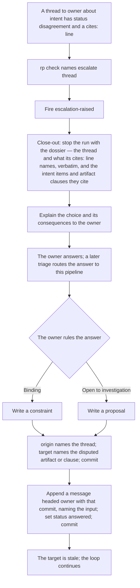

# Owner escalation

This chart mirrors [`reference/run/loop.md`](../../skills/radical-pipelines/reference/run/loop.md) § Owner escalation and [`reference/run/state.md`](../../skills/radical-pipelines/reference/run/state.md) § Owner territory: only a disagreement about what the intent means or demands, or evidence that every kind of approach fails an intent goal or constraint, reaches the owner, and the answer returns as later input.

