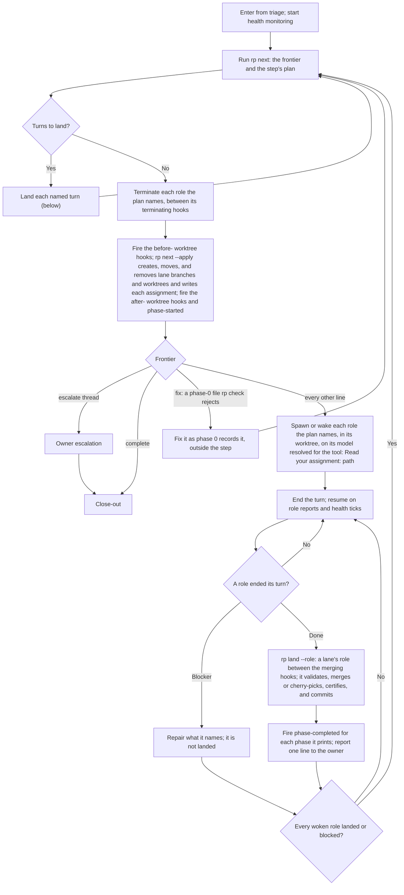

# Autonomous loop

This chart mirrors [`reference/run/loop.md`](../../skills/radical-pipelines/reference/run/loop.md): each step runs `rp next` for its plan, fires the plan's hooks around `rp next --apply`, wakes the roles the plan names, lands each turn with `rp land`, and repeats until the frontier is `complete` or `escalate`.

