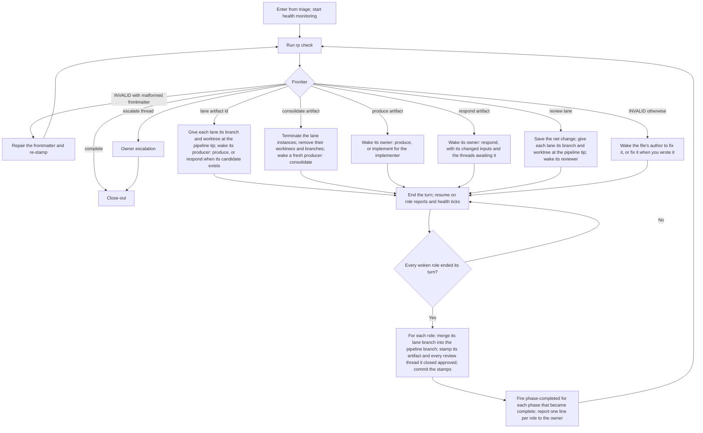

# Autonomous loop

This chart mirrors [`reference/run/loop.md`](../../skills/radical-pipelines/reference/run/loop.md): each step runs `rp check`, wakes the roles its frontier names, waits for their turns to end, lands them, and repeats until the frontier is `complete` or `escalate`.

