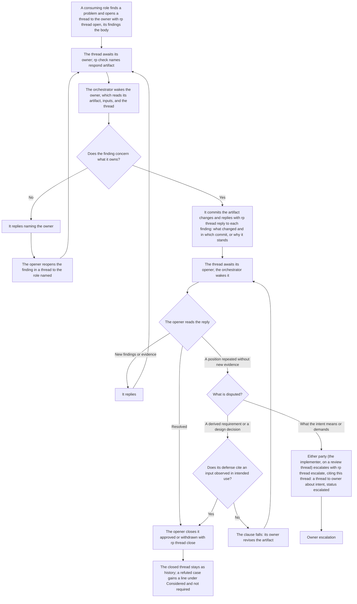

# A thread's lifecycle

This chart mirrors [`reference/run/state.md`](../../skills/radical-pipelines/reference/run/state.md) § Threads and the thread rules in the agent profiles: a role that consumes an artifact opens a thread to its owner, each message ends its author's turn, and the frontier wakes whichever party the thread awaits. A reviewer opens threads to the implementer only; the implementer carries a finding that questions a requirement or a design decision to that clause's owner in a thread of its own.

