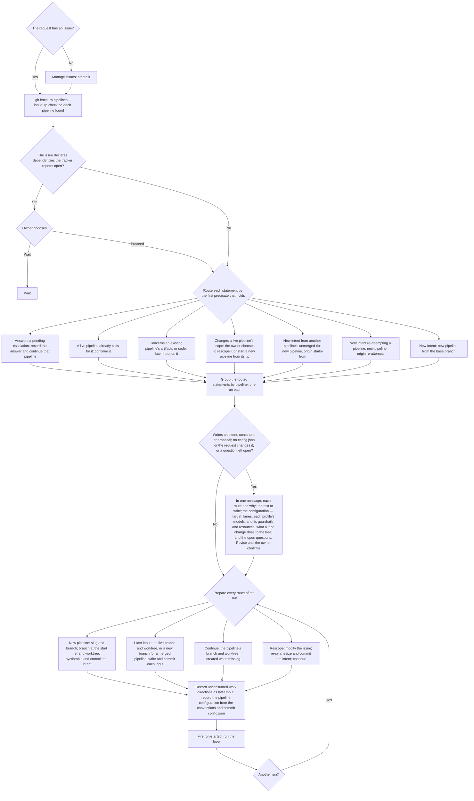

# Triage

This chart mirrors [`reference/entries/triage.md`](../../skills/radical-pipelines/reference/entries/triage.md), from issue normalization and the pipeline scan through first-match routing, confirmation, preparation, and the run.

